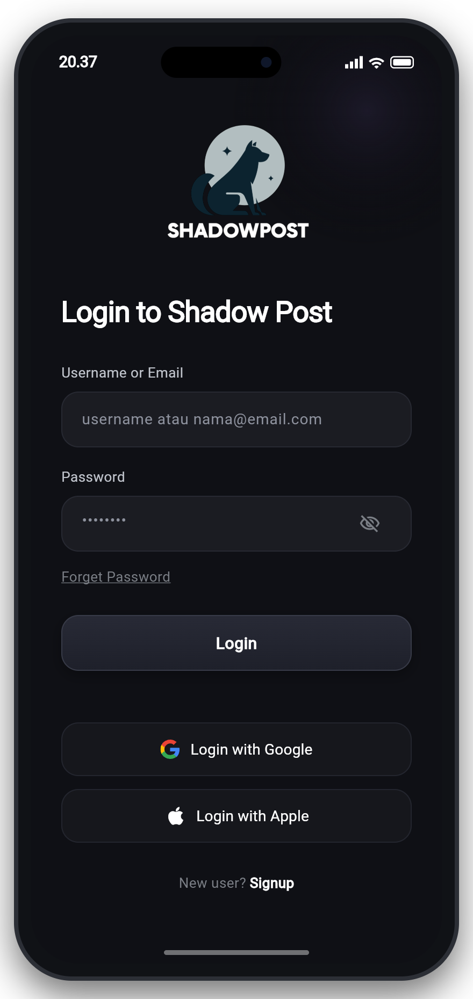
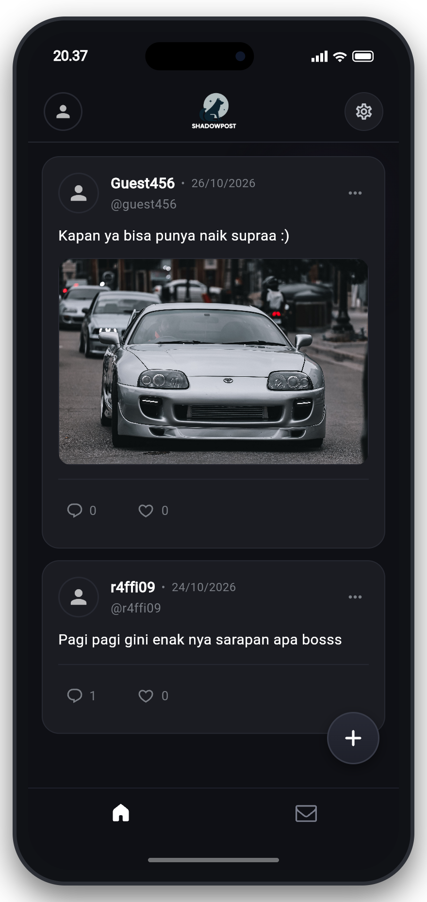
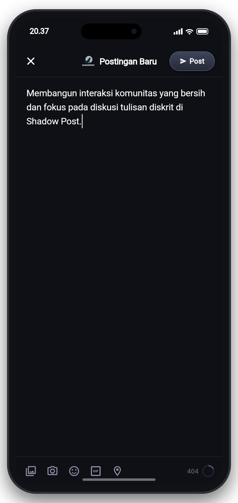
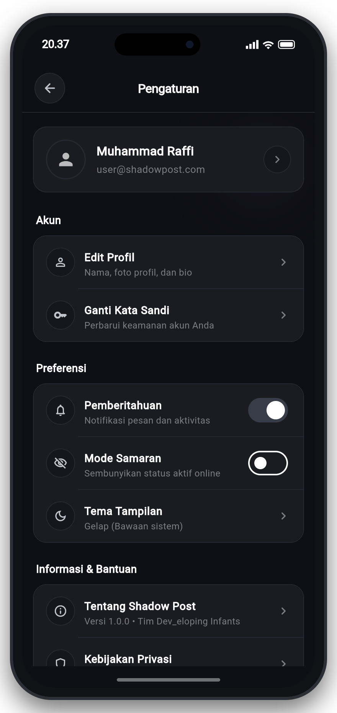

# ShadowPost

Dev_eloping Infants - Project UAS Software Development

### Anggota Tim:
- **Muhammad Raffi Hermawan** (535220259) - Reviewer Tim
- **Jason Wiedardi Limtara** (535220212)
- **Wilson Alfando** (535220219)
- **Christ Thaddeus** (535220196)

---

Aplikasi media sosial dan microblogging berbasis Flutter yang mengedepankan postingan secara anonim.

---

## Tampilan Layar

| Login Screen | Beranda |
| :---: | :---: |
|  |  |

| Post Screen | Pengaturan Screen |
| :---: | :---: |
|  |  |

---

## Daftar Layar

- **Login Screen**: Halaman autentikasi pengguna dengan input username/email dan kata sandi serta halaman Signup.
- **Beranda**: Menampilkan timeline postingan real-time dari pengguna lain secara anonim.
- **Post Screen**: Halaman untuk menyusun dan mempublikasikan postingan baru ke timeline.
- **Pengaturan Screen**: Pusat konfigurasi akun.

---

## Cara Menjalankan

1. Unduh paket dependensi:
   ```bash
   flutter pub get
   ```

2. Jalankan project:
   - **Browser (Chrome)**:
     ```bash
     flutter run -d chrome
     ```
   - **Perangkat Fisik / Emulator**:
     ```bash
     flutter run
     ```
